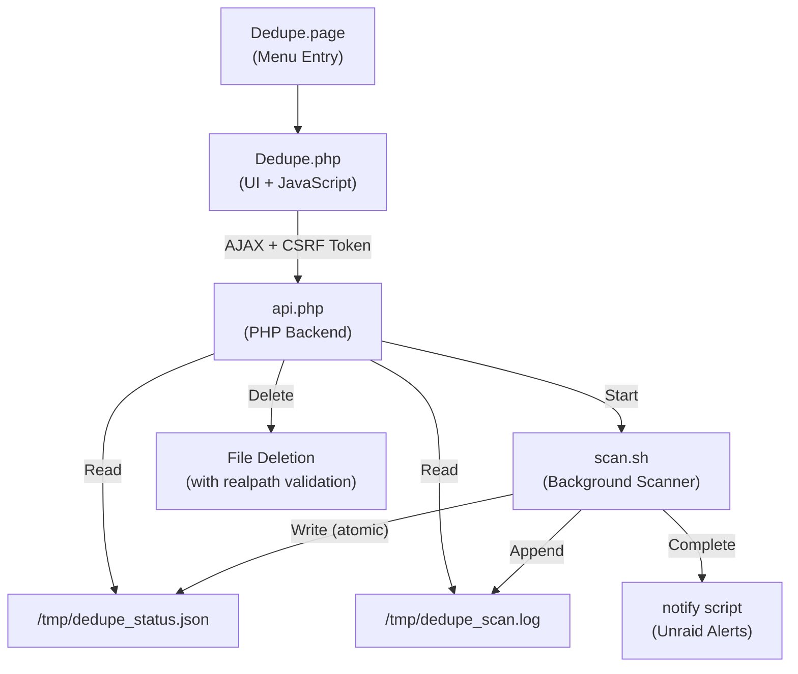

# Dedupe Plugin — Roadmap & Architecture Review

This document contains the original code review, security audit, and 4-phase development roadmap for the Unraid Dedupe plugin.

---

## 🏗️ Architecture Overview

---

## 4-Phase Roadmap

### ✅ Phase 1: Critical Security (Completed in v2026.10.30)
- [x] **#1 CSRF Token Compatibility**: Verified Unraid Dynamix auto-appends CSRF tokens on all `$.post()` requests.
- [x] **#2 XSS Prevention**: Added text-node DOM escaping (`escapeHtml()`) across all file paths and data tables.
- [x] **#3 Path Traversal**: Enforced `realpath()` validation requiring targets to resolve strictly inside `/mnt/`.
- [x] **#4 Command Injection via PID**: Enforced numeric-only regex (`^\d+$`) and `/proc/$pid` verification before invoking any process kill/stop commands.

### ✅ Phase 2: Core Bug Fixes (Completed in v2026.10.30)
- [x] **#5 Status Check on Page Load**: Added jQuery ready handler that correctly manages `idle`, `running`, `paused`, and `complete` states.
- [x] **#6 Empty Results Handling**: Gracefully handles zero-file or zero-duplicate scans without throwing script errors.
- [x] **#7 Deep Verification**: Fully implemented byte-by-byte comparison (`cmp -s`) when enabled, removing hash-collision false positives.
- [x] **#8 Progress Bar Division-by-Zero**: Added guards in `awk` when potential candidate count is 0.
- [x] **#9 Atomic Status Writes**: Script writes to `.tmp` files before renaming to eliminate corrupted JSON reads.
- [x] **#10 Icon Overhaul**: Embedded official FontAwesome clone icon and created clean 96×96 Unraid-orange icon for Community Applications.

### ✅ Phase 3: Core Usability (Completed in v2026.10.30)
- [x] **#11 Minimum File Size Filter**: Dropdown to skip files under 1 KB, 100 KB, 1 MB (default), 10 MB, 100 MB.
- [x] **#13 Path Exclusions**: Comma-separated exclude filter for `.Recycle.Bin`, `@eaDir`, `.Trash`, etc.
- [x] **#14 Persistent Results**: Results cached in `/tmp/dedupe_status.json` so navigating away doesn't lose your scan.
- [x] **#20 AJAX Error Handling**: Added `.fail()` handlers to provide user feedback when requests fail.
- [x] **#21 Proper HTTP Headers**: Standardized `Content-Type: application/json; charset=utf-8` on API endpoints.

---

### ⏳ Phase 4: Polish & Advanced Features (Current Work)

- [ ] **#12 File Extension Filters**: Scan only specific types (e.g. `*.mkv, *.mp4` or `*.iso`) or exclude specific extensions (`*.nfo`, `*.srt`).
- [ ] **#15 Smart "Keep" Selection**:
  - Keep Oldest (by modification date `mtime`)
  - Keep Newest
  - Keep by Preferred Path/Disk (e.g. keep cache or specific share, mark array/download copy for deletion)
  - Keep Shortest Path
- [ ] **#16 Enhanced Delete Confirmation & Safety**:
  - Detailed modal listing exact files & directories about to be deleted
  - Optional "Dry Run" mode
- [ ] **#17 Log Management & Size Limits**:
  - Bounded log file size / rotation to prevent `/tmp` RAM exhaustion.
- [ ] **#18 Scheduled Scans (Cron)**:
  - Weekly / Monthly automated duplicate scans with background Unraid notification alerts.
- [ ] **#22 Polling Optimization**:
  - Smarter polling backoff to reduce idle server requests.
